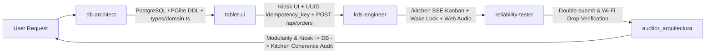

# Bistro OS — Self-Ordering Kiosk & Real-Time KDS

A full-stack fast-casual restaurant prototype built with **Next.js 15 (App Router)**, **TypeScript**, **Tailwind CSS**, and **PostgreSQL** (embedded WASM via `@electric-sql/pglite` locally, or standard `pg` pool via `DATABASE_URL`).

- **Self-Ordering Kiosk (`/kiosk`)**: Touch-first menu catalog, per-unit combo bundling with side/drink swaps, ingredient customizations, and idempotent order submission (CAD pricing).
- **Kitchen Display System (`/kitchen`)**: Real-time Kanban board fed by Server-Sent Events (`/api/realtime`), synthetic Web Audio API alerts, Screen Wake Lock, and elapsed-time color indicators.

### Quick Start

```bash
npm install
npm run db:seed
npm run dev
```

---

## Agent Architecture (`.agents/`)

This workspace includes specialized AI agent roles, automated audit rules, and a multi-agent orchestration log under `.agents/`.

### How the Agents Work Together



### 1. Core Domain Roles (`.agents/roles/`)

- **`db-architect`** ([`db-architect.md`](.agents/roles/db-architect.md))  
  **Scope:** Data layer, SQL schemas, and TypeScript contracts.  
  **Technical Responsibilities:** Designs relational PostgreSQL/PGlite schemas, enforces `idempotency_key` (`UUID UNIQUE`) constraints to prevent duplicate orders during unstable Wi-Fi retries, manages order lifecycle states (`PENDING`, `IN_PREP`, `READY`, `SERVED`, `CANCELLED`), and keeps `types/domain.ts` synchronized with database tables.

- **`tablet-ui`** ([`tablet-ui.md`](.agents/roles/tablet-ui.md))  
  **Scope:** Customer-facing ordering interfaces (`/kiosk`, `/mesa/[id]`).  
  **Technical Responsibilities:** Builds touch-ergonomic UIs (minimum `48px x 48px` hit targets), native HTML5 `<dialog>` / Popover API modals without heavy third-party modal libraries, client-side cart persistence (`localStorage` / `IndexedDB`), and client-generated UUID v4 idempotency tokens prior to `POST /api/orders` dispatch.

- **`kds-engineer`** ([`kds-engineer.md`](.agents/roles/kds-engineer.md))  
  **Scope:** Real-time Kitchen Display System (`/kitchen`).  
  **Technical Responsibilities:** Implements low-latency order boards over SSE (`/api/realtime`), integrates the **Screen Wake Lock API** to prevent tablet sleep during service, uses the **View Transitions API** for 60 FPS card transitions, synthesizes dual-tone notification chimes via the **Web Audio API** (zero external audio files), and renders elapsed-time semáforo badges (`<10m` green, `10–20m` orange, `>20m` red).

- **`reliability-tester`** ([`reliability-tester.md`](.agents/roles/reliability-tester.md))  
  **Scope:** Concurrency, data integrity, and network resilience.  
  **Technical Responsibilities:** Validates system behavior under hostile restaurant conditions—burst double-submit tests (5 rapid clicks confirming only 1 order is persisted), modifier/pricing consistency, and client state recovery across mid-order network drops.

### 2. Automated Architecture Auditor (`.agents/rules/`)

- **`auditor_arquitectura`** ([`auditor_arquitectura.md`](.agents/rules/auditor_arquitectura.md))  
  **Scope:** Structural code reviews and architectural coherence.  
  **Technical Responsibilities:** Invoked after structural refactors or on demand to audit component modularity, Next.js App Router boundaries (Server vs. Client components, pure domain hooks), end-to-end state coherence (`kiosk -> DB -> KDS`), atomic database mutations, and touch UX performance. Explicitly excludes security/auth and test-suite audits during rapid prototyping.

### 3. Multi-Agent Teamwork Workspace (`.agents/teamwork/`)

Historical execution workspace from the initial `/teamwork` multi-agent build, containing scoped briefings, dispatches, and handoffs for:
- **Control & Monitoring:** `orchestrator` (milestone gating), `sentinel` (stall/health monitoring), `interviewer` (requirements capture).
- **Discovery & Research:** `survey_explorer_infra`, `survey_miner_db`, `survey_miner_ui`, `m1_explorer_1..3`, `audit_remediation_explorer`.
- **Implementation & Verification:** `m1_worker_1`, `frontend_ui_worker`, `e2e_test_writer`, `m1_reviewer_1..2`, `m1_challenger_1..2`, `m1_auditor_1`, and `victory_auditor` (independent end-to-end verification against the live Next.js server).
